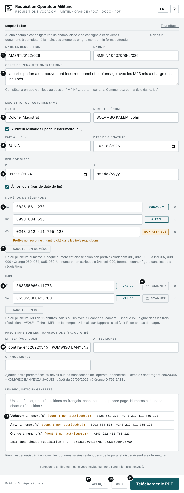
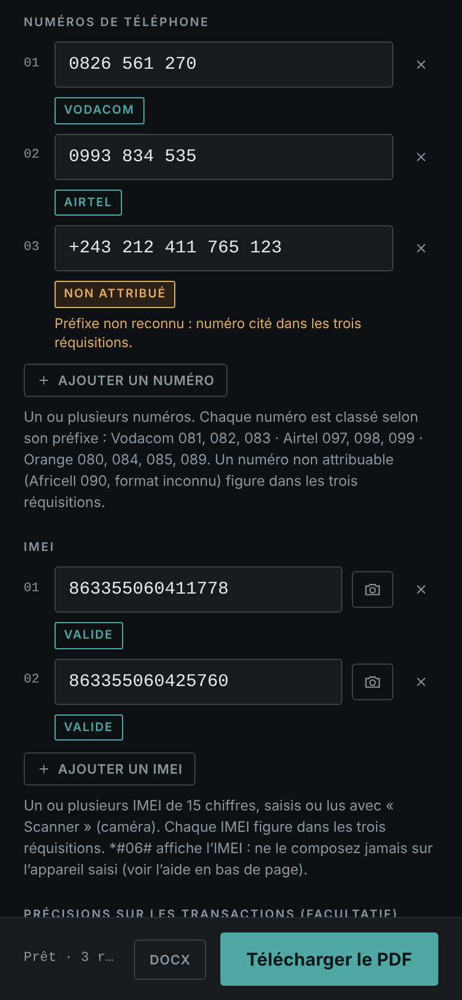
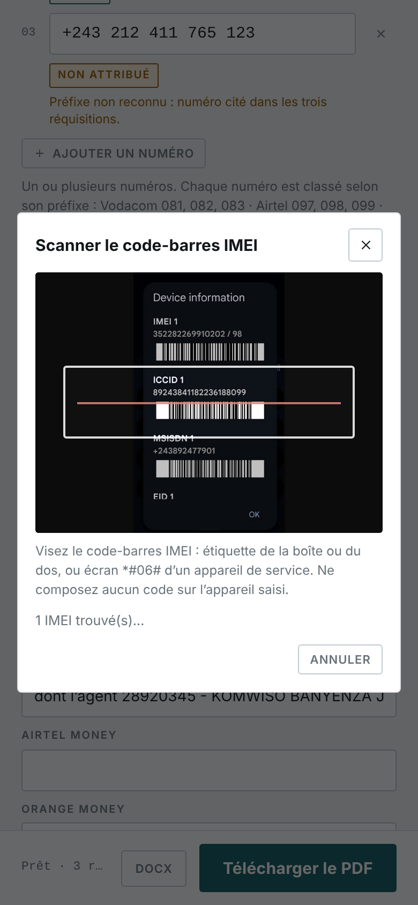
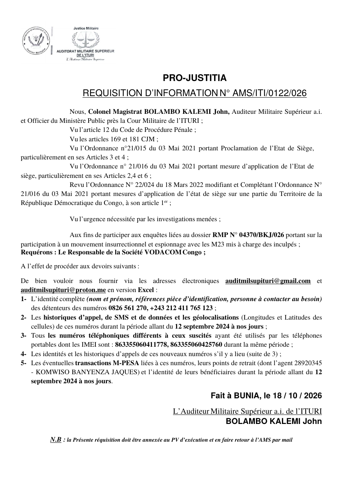
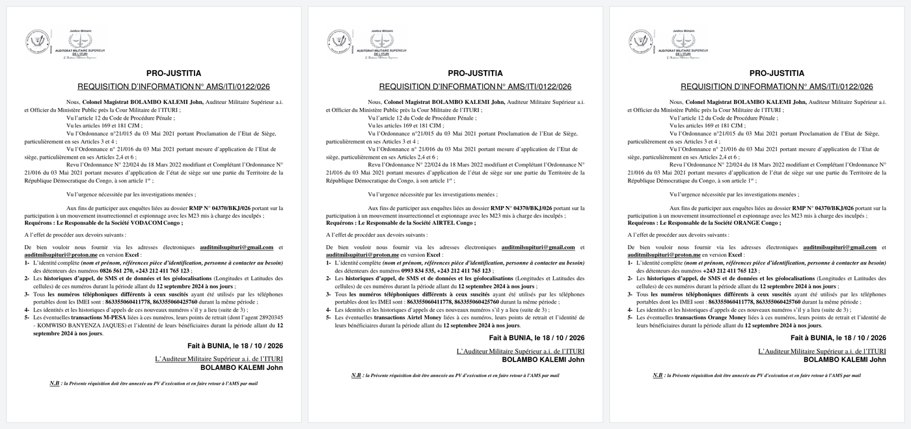
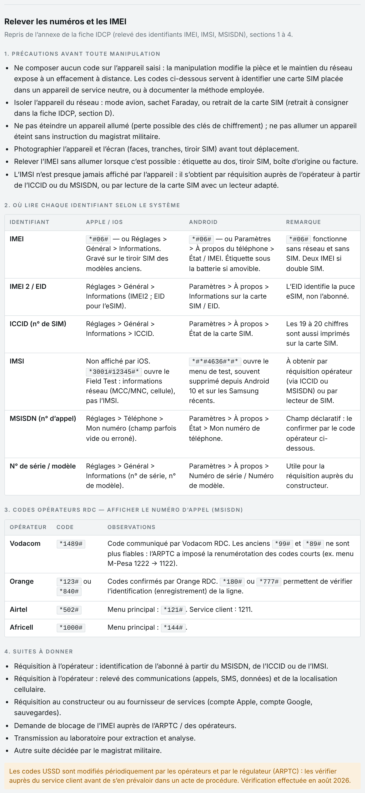
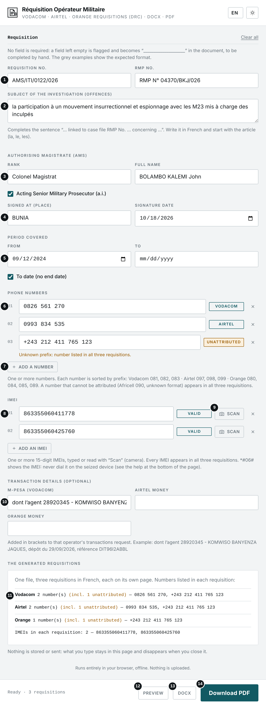
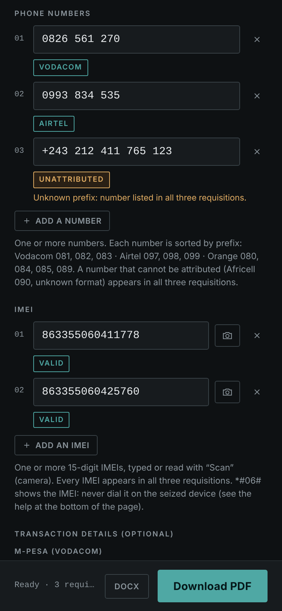
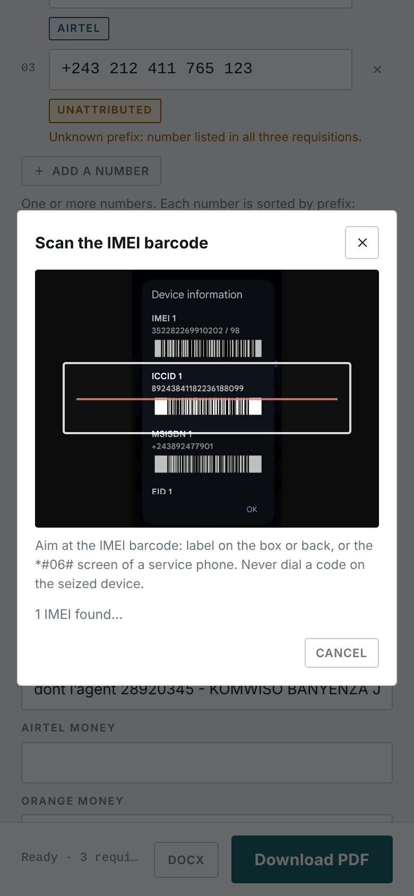
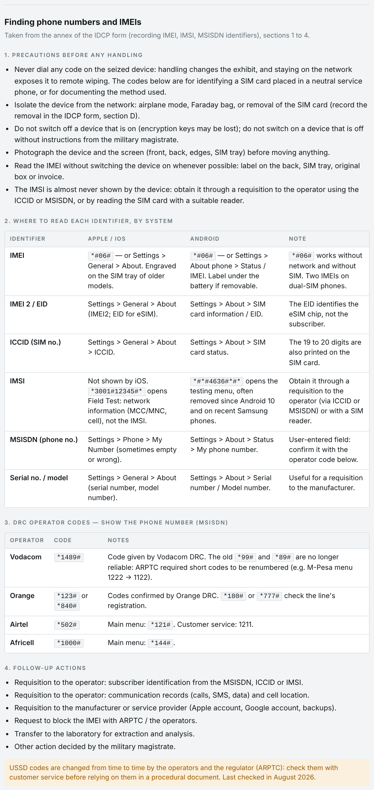

# Réquisition Opérateur Militaire · Military Operator Requisition

**`REQUISITION_OPERATEUR_MIL.html`** · Réquisitions Vodacom · Airtel · Orange (RDC) · DOCX + PDF · Hors ligne — *Offline*

**[Français](#français) · [English](#english)**

📘 Manuel d'utilisation / User manual (FR) : [PDF](Manuel_REQUISITION_OPERATEUR_MIL.pdf) · [Word](Manuel_REQUISITION_OPERATEUR_MIL.docx)

---

## Français

### À quoi sert cet outil

Cet outil rédige en une fois les trois réquisitions d'information adressées aux opérateurs de téléphonie de la RDC (Vodacom, Airtel et Orange), sur le modèle de l'Auditorat Militaire Supérieur de l'Ituri. Vous saisissez la réquisition, le magistrat, la période, les numéros de téléphone et les IMEI (au clavier ou en scannant le code-barres avec la caméra) ; l'outil classe les numéros par opérateur et produit un seul fichier Word (DOCX) ou PDF contenant les trois réquisitions, chacune sur sa propre page. Aucun champ n'est obligatoire : un champ laissé vide est signalé et devient « `____________________` » dans le document, à compléter à la main.

### Avant de commencer

- Ouvrez le fichier REQUISITION_OPERATEUR_MIL.html par double-clic : il s'affiche dans votre navigateur (Chrome, Edge, Firefox ou Safari récents). Aucune installation n'est nécessaire.
- L'outil fonctionne sans connexion Internet. Aucune donnée n'est envoyée ni enregistrée : ce que vous saisissez disparaît à la fermeture de la page.
- La langue de l'interface (FR, EN, SW, LN) se choisit en haut à droite, à côté du bouton de thème clair ou sombre. Les réquisitions générées sont toujours en français.

### L'écran en un coup d'œil

1. N° de la réquisition et n° RMP
2. Objet de l'enquête (infractions)
3. Magistrat qui autorise : grade, nom et prénom, case « a.i. »
4. Lieu et date de signature
5. Période visée : du… au…, ou « À nos jours »
6. Numéros de téléphone, avec l'opérateur détecté
7. Ajouter un numéro (bouton +)
8. IMEI, avec le contrôle de la somme de contrôle
9. Scanner : lit le code-barres IMEI avec la caméra
10. Précisions facultatives sur les transactions (M-PESA, Airtel Money, Orange Money)
11. Répartition : numéros cités dans chaque réquisition
12. Aperçu : ouvre le PDF dans un nouvel onglet
13. Télécharger le DOCX (modifiable dans Word)
14. Télécharger le PDF

#### Sur téléphone (thème sombre)

### Utilisation pas à pas

1. Saisissez le n° de la réquisition (ex. AMS/ITI/0122/026) et le n° RMP (ex. 04370/BKJ/026 ; « RMP N° » peut être tapé ou non).
2. Décrivez l'objet de l'enquête en commençant par l'article : il complète la phrase « … liées au dossier RMP N° … portant sur … ».
3. Renseignez le grade et le nom du magistrat (ex. Colonel Magistrat · BOLAMBO KALEMI John), cochez « a.i. » s'il est intérimaire, puis le lieu et la date de signature (date du jour par défaut).
4. Indiquez la période : date de début, puis date de fin ou « À nos jours ».
5. Saisissez les numéros de téléphone ; le bouton « Ajouter un numéro » (ou la touche Entrée) ajoute une ligne. L'opérateur détecté s'affiche à côté de chaque numéro.
6. Saisissez les IMEI de la même façon, ou cliquez sur « Scanner » pour lire le code-barres avec la caméra (voir ci-dessous). « Valide » confirme la somme de contrôle ; « À vérifier » signale une probable faute de frappe.
7. Si besoin, ajoutez une précision sur les transactions d'un opérateur (agent, dépôt, référence).
8. Contrôlez la répartition et la liste des champs vides, puis cliquez sur « Aperçu », « DOCX » ou « Télécharger le PDF ». Seule une valeur invalide (numéro, IMEI, dates dans le désordre) bloque la génération : la liste des points à corriger s'affiche alors.
9. Relisez, imprimez et faites signer chaque réquisition.

#### Répartition des numéros

| Préfixe | Réquisition |
|---|---|
| **081, 082, 083** | Vodacom |
| **097, 098, 099** | Airtel |
| **080, 084, 085, 089** | Orange |
| **090 (Africell) ou format non reconnu** | Les trois réquisitions |

Les numéros nationaux sont mis en forme (0826 561 270), quelle que soit la saisie (+243…, 00243…, 0…). Les IMEI figurent dans les trois réquisitions. Un opérateur sans numéro reçoit une réquisition fondée sur les IMEI seulement.

#### Devoirs demandés à chaque opérateur

| Avec des numéros | Sans numéro |
|---|---|
| 1. Identité complète des détenteurs des numéros | 1. Numéros utilisés par les IMEI pendant la période |
| 2. Historiques d'appel, SMS, données et géolocalisations | 2. Identités, historiques et géolocalisations de ces numéros |
| 3. Autres numéros utilisés par les IMEI | 3. Transactions d'argent mobile |
| 4. Identités et historiques de ces nouveaux numéros | |
| 5. Transactions d'argent mobile (M-PESA, Airtel Money, Orange Money) | |

Les réponses sont demandées en version Excel aux adresses auditmilsupituri@gmail.com et auditmilsupituri@proton.me.

#### Champs vides

| Champ vide | Dans le document |
|---|---|
| **N° de réquisition, RMP, grade, nom, lieu, dates** | `____________________` |
| **Objet de l'enquête** | une ligne plus longue (60 traits) |
| **Aucun numéro de téléphone** | « des détenteurs des numéros `____________________` » dans les trois réquisitions |
| **Aucun IMEI** | « dont les IMEI sont : `____________________` » |

Chaque champ vide est signalé en orange sous le champ et rappelé dans la liste « Champs vides » sous la répartition.

### Scanner le code-barres IMEI

1. Cliquez sur « Scanner » à côté d'une ligne IMEI, puis autorisez la caméra.
2. Placez le code-barres IMEI dans le cadre : étiquette de la boîte ou du dos du téléphone, ou écran *#06# d'un appareil de service. Rapprochez-vous pour que le code remplisse le cadre.
3. L'outil retient uniquement un IMEI valide (15 chiffres, somme de contrôle juste) ; l'ICCID de la carte SIM est ignoré. Avec deux SIM, les deux IMEI sont proposés.
4. Si l'écran affiche aussi le numéro de ligne (MSISDN), il est proposé, décoché : cochez-le pour l'ajouter aux numéros de téléphone.
5. Vérifiez, puis cliquez sur « Ajouter ». La caméra s'arrête dès la fermeture de la fenêtre ; aucune image n'est enregistrée ni envoyée.

La caméra fonctionne dans Chrome, Edge et Firefox récents, et sur téléphone lorsque l'outil est ouvert en https (par exemple GitHub Pages). Ne composez jamais *#06# sur un appareil saisi.

### Résultat

*Réquisition Vodacom générée (page 1 du fichier).*

*Les trois réquisitions du fichier : Vodacom, Airtel, Orange.*

### Aide : relever les numéros et les IMEI

Le bas de la page reprend les sections 1 à 4 de l'annexe de la fiche IDCP : précautions avant toute manipulation, où lire chaque identifiant (iOS et Android), codes opérateurs RDC pour afficher le numéro (Vodacom *1489#, Orange *123# ou *840#, Airtel *502#, Africell *1000#) et suites à donner. L'IMEI s'affiche avec *#06#.

### Bonnes pratiques

- Ne composez aucun code sur un appareil saisi : relevez ou scannez l'IMEI sur l'étiquette, le tiroir SIM ou la boîte, ou utilisez un appareil de service.
- Relisez la liste des champs vides : chaque « `____` » devra être complété à la main avant signature.
- Vérifiez chaque IMEI signalé « À vérifier » : une seule erreur de chiffre vise un autre appareil.
- Le DOCX reste modifiable dans Word pour une correction de dernière minute ; le PDF est prêt à imprimer.
- Relisez la répartition avant de générer : un numéro mal classé serait envoyé au mauvais opérateur.

### En cas de problème

| Problème | Solution |
|---|---|
| **La génération ne se lance pas** | Une valeur est invalide (numéro, IMEI, dates dans le désordre) : la liste des points à corriger s'affiche sous la répartition. |
| **« Scanner » n'ouvre pas la caméra** | Autorisez la caméra pour cette page, ou ouvrez l'outil en https (GitHub Pages). Sur iPhone, un fichier ouvert depuis l'app Fichiers n'a pas accès à la caméra. |
| **Le code-barres n'est pas lu** | Rapprochez le téléphone pour que le code remplisse le cadre, évitez les reflets, tenez l'appareil immobile. Sinon, saisissez l'IMEI au clavier. |
| **Un numéro est « Non attribué »** | Son préfixe n'est pas reconnu (ou c'est un numéro Africell) : il figure dans les trois réquisitions. Vérifiez la saisie. |
| **« Aperçu » n'ouvre rien** | Le navigateur bloque les fenêtres : autorisez-les pour ce fichier, ou utilisez « Télécharger le PDF ». |
| **Un caractère apparaît comme « ? » dans le PDF** | Il n'est pas pris en charge par la police du PDF (écritures non latines). Il est conservé dans le DOCX. |
| **Les polices du DOCX diffèrent du modèle** | Berlin Sans FB Demi et Britannic Bold sont des polices Microsoft Office : sans elles, Word les remplace. |

### Confidentialité

L'outil fonctionne entièrement sur votre appareil, sans connexion Internet. Aucune donnée n'est transmise ni conservée, en dehors des fichiers que vous téléchargez vous-même. Seuls la langue et le thème sont mémorisés.

---

## English

### What this tool is for

This tool drafts, in one go, the three information requisitions sent to the DRC mobile operators (Vodacom, Airtel and Orange), following the template of the Senior Military Prosecutor's Office (Auditorat Militaire Supérieur) of Ituri. You enter the requisition, the magistrate, the period, the phone numbers and the IMEIs (typed or scanned from the barcode with the camera); the tool sorts the numbers by operator and produces a single Word (DOCX) or PDF file containing the three requisitions, each on its own page. No field is required: a field left empty is flagged and becomes “`____________________`” in the document, to be completed by hand.

### Before you start

- Double-click REQUISITION_OPERATEUR_MIL.html: it opens in your browser (recent Chrome, Edge, Firefox or Safari). Nothing to install.
- The tool works without an Internet connection. No data is sent or stored: what you type disappears when you close the page.
- Choose the interface language (FR, EN, SW, LN) at the top right, next to the light/dark theme button. The generated requisitions are always in French.

### The screen at a glance

1. Requisition no. and RMP no.
2. Subject of the investigation (offences)
3. Authorising magistrate: rank, full name, “a.i.” box
4. Place and signature date
5. Period covered: from… to…, or “To date”
6. Phone numbers, with the detected operator
7. Add a number (+ button)
8. IMEIs, with checksum control
9. Scan: reads the IMEI barcode with the camera
10. Optional transaction details (M-PESA, Airtel Money, Orange Money)
11. Distribution: numbers listed in each requisition
12. Preview: opens the PDF in a new tab
13. Download the DOCX (editable in Word)
14. Download the PDF

#### On a phone (dark theme)

### Step by step

1. Enter the requisition no. (e.g. AMS/ITI/0122/026) and the RMP no. (e.g. 04370/BKJ/026; typing “RMP N°” is optional).
2. Describe the subject of the investigation in French, starting with the article: it completes the sentence “… liées au dossier RMP N° … portant sur …”.
3. Enter the magistrate's rank and name (e.g. Colonel Magistrat · BOLAMBO KALEMI John), tick “a.i.” if acting, then the place and signature date (today by default).
4. Enter the period: start date, then end date or “To date”.
5. Enter the phone numbers; “Add a number” (or the Enter key) adds a row. The detected operator is shown next to each number.
6. Enter the IMEIs the same way, or click “Scan” to read the barcode with the camera (see below). “Valid” confirms the checksum; “Check” flags a likely typo.
7. If needed, add a detail about one operator's transactions (agent, deposit, reference).
8. Check the distribution and the list of empty fields, then click “Preview”, “DOCX” or “Download PDF”. Only an invalid value (number, IMEI, dates out of order) blocks generation: the list of items to fix then appears.
9. Proofread, print and have each requisition signed.

#### Number distribution

| Prefix | Requisition |
|---|---|
| **081, 082, 083** | Vodacom |
| **097, 098, 099** | Airtel |
| **080, 084, 085, 089** | Orange |
| **090 (Africell) or unrecognised format** | All three requisitions |

National numbers are formatted (0826 561 270) whatever the input (+243…, 00243…, 0…). IMEIs appear in all three requisitions. An operator with no number gets a requisition based on the IMEIs only.

#### Requests made to each operator

| With numbers | Without numbers |
|---|---|
| 1. Full identity of the number holders | 1. Numbers used by the IMEIs during the period |
| 2. Call, SMS and data records, and cell locations | 2. Identities, records and locations of those numbers |
| 3. Other numbers used by the IMEIs | 3. Mobile money transactions |
| 4. Identities and records of those new numbers | |
| 5. Mobile money transactions (M-PESA, Airtel Money, Orange Money) | |

Answers are requested as Excel files at auditmilsupituri@gmail.com and auditmilsupituri@proton.me.

#### Empty fields

| Empty field | In the document |
|---|---|
| **Requisition no., RMP, rank, name, place, dates** | `____________________` |
| **Subject of the investigation** | a longer line (60 underscores) |
| **No phone number** | “des détenteurs des numéros `____________________`” in all three requisitions |
| **No IMEI** | “dont les IMEI sont : `____________________`” |

Each empty field is flagged in orange below the field and listed under “Empty fields” below the distribution.

### Scanning the IMEI barcode

1. Click “Scan” next to an IMEI row, then allow the camera.
2. Place the IMEI barcode in the frame: label on the phone's box or back, or the *#06# screen of a service phone. Move closer so the code fills the frame.
3. The tool only keeps a valid IMEI (15 digits, correct checksum); the SIM card's ICCID is ignored. With two SIMs, both IMEIs are offered.
4. If the screen also shows the line number (MSISDN), it is offered, unticked: tick it to add it to the phone numbers.
5. Check, then click “Add”. The camera stops as soon as the window closes; no image is stored or sent.

The camera works in recent Chrome, Edge and Firefox, and on phones when the tool is opened over https (e.g. GitHub Pages). Never dial *#06# on a seized device.

### Result

*Generated Vodacom requisition (page 1 of the file).*

*The three requisitions in the file: Vodacom, Airtel, Orange.*

### Help: finding numbers and IMEIs

The bottom of the page reproduces sections 1 to 4 of the IDCP form annex: precautions before any handling, where to read each identifier (iOS and Android), DRC operator codes to show the phone number (Vodacom *1489#, Orange *123# or *840#, Airtel *502#, Africell *1000#) and follow-up actions. The IMEI is shown with *#06#.

### Good practice

- Never dial a code on a seized device: read or scan the IMEI from the label, SIM tray or box, or use a service phone.
- Review the list of empty fields: every “`____`” must be completed by hand before signing.
- Check every IMEI marked “Check”: a single wrong digit targets another device.
- The DOCX stays editable in Word for last-minute corrections; the PDF is ready to print.
- Review the distribution before generating: a misclassified number would be sent to the wrong operator.

### Troubleshooting

| Problem | Solution |
|---|---|
| **Nothing is generated** | A value is invalid (number, IMEI, dates out of order): the list of items to fix appears under the distribution. |
| **“Scan” does not open the camera** | Allow the camera for this page, or open the tool over https (GitHub Pages). On iPhone, a file opened from the Files app has no camera access. |
| **The barcode is not read** | Move the phone closer so the code fills the frame, avoid glare, hold still. Otherwise, type the IMEI. |
| **A number is “Unattributed”** | Its prefix is not recognised (or it is an Africell number): it appears in all three requisitions. Check what you typed. |
| **“Preview” opens nothing** | The browser blocks pop-ups: allow them for this file, or use “Download PDF”. |
| **A character shows as “?” in the PDF** | The PDF font does not support it (non-Latin scripts). It is kept in the DOCX. |
| **DOCX fonts differ from the template** | Berlin Sans FB Demi and Britannic Bold are Microsoft Office fonts: without them, Word substitutes them. |

### Privacy

The tool runs entirely on your device, without an Internet connection. No data is sent or kept, other than the files you download yourself. Only the language and theme are remembered.

---

*Bibliothèques intégrées / Embedded libraries: pdf-lib 1.17.1 (MIT), JSZip 3.10.1 (MIT), ZXing 0.21.3 (@zxing/library, Apache 2.0 ; lecteur Code 128 corrigé / Code 128 reader fixed).*
